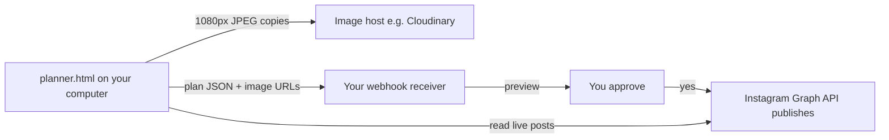

# Setup guide (for people and their AI agents)

**Version 0 — updated 25 October 2026.** To report a bug, open this repository's **Issues** tab. See README.md for what to include and how to remove private information.

This guide covers connecting `planner.html` to Instagram, an image host, and (optionally) an AI agent that publishes for you. See `README.md` for how the planner itself works.

> **For AI agents reading this repo:** follow the "Agent setup guide" below. Ask the user the questions in **Step 0** before doing anything else, and never ask them to paste tokens or keys into chat.

---

## What it does

- **Plan:** drag-and-drop grid of planned posts (single images and carousels), with captions.
- **Live feed:** pulls your real, already-published posts from the Instagram API and shows them as locked tiles below your plan.
- **Send (optional):** resizes "ready" posts to 1080 px JPEGs, uploads those copies to an image host, and POSTs a JSON plan to a webhook of your choice. Whatever receives the webhook does the publishing.

The planner itself never publishes. Publishing is done by whatever receives the plan, ideally an agent that shows you a preview and waits for your approval.

## How it fits together



## Security rules (read before setup)

1. **Run it locally.** Download/clone the repo and open `planner.html` from your own disk. Don't run it from a public hosted page with your keys in it.
2. **Keys live only in your browser.** Tokens, webhook key and upload preset are entered in the planner's **Settings** panel and stored in `localStorage` on your device. They are never written into the file. Never commit them.
3. **Originals never leave your computer.** Only resized 1080 px JPEG copies are uploaded (Instagram caps at 1080 px wide anyway). Delete them from the host after publishing.
4. **Don't paste secrets into AI chats.** Use your agent's secure secret input, or type them straight into Settings.
5. **Tokens expire** about every 60 days. Refresh them (see below) or regenerate.

---

## Agent setup guide

### Step 0: Ask the user

Ask these before starting:

1. "Which Instagram account(s) do you want to connect? Are they Business or Creator accounts?" (Personal accounts can't use the API; switching to Creator is free in the Instagram app.)
2. "Do you just want planning plus your live feed, or publishing too?"
3. If publishing: "Do you have a Grok Bot set up? Or would you rather publish another way?" Then follow **Path A** (Grok Bot) or **Path B** (your own way).

### Step 1: Meta app and Instagram token (everyone)

Official docs: [Instagram Platform](https://developers.facebook.com/docs/instagram-platform) and [Content publishing](https://developers.facebook.com/docs/instagram-platform/content-publishing).

1. Go to [Meta for Developers](https://developers.facebook.com/apps/) and create an app.
2. Choose the use case **"Manage messaging & content on Instagram"**. It's under the **All** filter in the wizard.
3. Use **API setup with Instagram login**. A business portfolio is optional, and development mode is fine for your own accounts.
4. Permissions: `instagram_business_basic` (read feed) and `instagram_business_content_publish` (publish). If adding one shows a "Something went wrong" popup, reload the page. It's often already added.
5. Under **App roles, then Roles, then Instagram Testers**, add each Instagram username. Type it, press **Enter** to make a chip, then click Add.
6. On each Instagram account, accept the invite at [instagram.com/accounts/manage_access](https://www.instagram.com/accounts/manage_access/), under the **Tester invites** tab.
7. Back on the app's Instagram API setup page, click **Generate access token** for each account. This is a long-lived token (about 60 days). Several tokens per account can exist at once.
8. Test it (in a terminal, never in chat):
   `curl "https://graph.instagram.com/me?fields=username,account_type&access_token=$IG_TOKEN"`

Refresh before expiry:
`GET https://graph.instagram.com/refresh_access_token?grant_type=ig_refresh_token&access_token=TOKEN`

### Step 2: Image host (only if publishing)

Instagram fetches images from a **public URL**, so local files can't be published directly. The planner defaults to **Cloudinary**:

1. Create a free [Cloudinary](https://cloudinary.com/) account and note your **cloud name**.
2. Go to **Settings, then Upload, then Upload presets, then Add upload preset**. Set **Signing mode: Unsigned**, set a folder (for example `your-folder`), and save. Copy the preset name.
   An unsigned preset lets the browser upload without your secret key, limited to that preset's rules. Never put your Cloudinary API secret in the planner.
3. The planner sends each image's `public_id` so the publisher can delete the copy after posting.

Other options: Cloudflare R2 with expiring signed URLs (most private), Supabase Storage, or ImgBB. Google Drive links are unreliable for Instagram.

### Step 3: Fill in the planner

Open `planner.html` locally, then open **Settings** and enter:
- Instagram token(s)
- Webhook URL and webhook key (from Path A or B)
- Cloudinary cloud name, unsigned preset and folder

### Path A: Publish with a Grok Bot

1. In Grok Bot, pick (or create) the bot that handles your social media.
2. Save each Instagram token to that bot as a secret using its secure secret input (for example `IG_TOKEN_<ACCOUNT>`). Don't paste tokens in the chat.
3. Ask the bot to create a **routine triggered by a webhook** with this behaviour:
   - Accept a POST with `Authorization: Bearer <key>` and reject anything else.
   - Validate the plan (see the payload below), save it, and **preview every post to me in chat** (images, caption, order, account).
   - **Publish only after I reply yes**, using the Instagram content publishing API. Then delete the hosted image copies with `public_id`, and report each post's permalink.
4. Copy the routine's **webhook URL** and **key** into the planner's Settings.
5. Do a test send with one post and check the preview arrives.

### Path B: Your own way

Anything that can receive an HTTPS POST and call the Instagram API works. For example:
- A small serverless function (Cloudflare Workers, Vercel, Netlify, AWS Lambda), with the tokens stored as environment secrets.
- Another AI agent or automation tool (n8n, Make, Zapier) with a webhook trigger.
- A local script on your computer (for example Node or Python) that you run when you're ready to publish.
- No publishing at all. Just plan, then post manually from your phone.

Keep a human approval step before publishing. Whatever you build should:
1. Check the Bearer key.
2. Show you the plan and wait for confirmation.
3. Publish (see "Publishing calls").
4. Delete the hosted copies.

### ⚠️ CORS: set this up first

The planner runs in a browser, so the receiver **must** allow cross-origin requests, or the send fails with a CORS error. The receiver should:
- Respond to `OPTIONS` preflight requests.
- Return `Access-Control-Allow-Origin` for the planner's origin. A page opened from `file://` sends `Origin: null`. If you serve it on `localhost`, allow that exact origin instead.
- Return `Access-Control-Allow-Headers: Authorization, Content-Type` and `Access-Control-Allow-Methods: POST, OPTIONS`.

If your receiver can't set CORS headers (some hosted webhooks, including Grok Bot routine webhooks, may not), use the included local relay `server.mjs` (Node.js 20+): set `PLANNER_WEBHOOK_URL` to your webhook URL, run `node server.mjs`, and open `http://127.0.0.1:4320/planner.html`. See the CORS section of `README.md`.

---

## Webhook payload

```json
{
  "plan_id": "2026-10-25T20-00-00Z-abc123",
  "account": "your_instagram_username",
  "posts": [
    {
      "position": 1,
      "type": "IMAGE",
      "caption": "Caption text #hashtag",
      "images": [
        { "filename": "post1.jpg", "mime": "image/jpeg", "url": "https://res.cloudinary.com/...", "public_id": "your-folder/abc" }
      ]
    }
  ]
}
```

- `type` is `IMAGE` or `CAROUSEL`. A carousel has 2 to 10 images.
- Captions can be up to 2,200 characters with at most 30 hashtags.
- Images are JPEG, max 1080 px wide.

## Publishing calls (Instagram Graph API)

Single image:
1. `POST https://graph.instagram.com/me/media` with `image_url` and `caption` returns a `creation_id`.
2. `POST https://graph.instagram.com/me/media_publish` with `creation_id`.

Carousel:
1. For each image, `POST /me/media` with `image_url` and `is_carousel_item=true` returns a child ID.
2. `POST /me/media` with `media_type=CAROUSEL`, `children=<id1,id2,...>` and `caption` returns a `creation_id`.
3. `POST /me/media_publish` with `creation_id`.

Read the live feed:
`GET https://graph.instagram.com/me/media?fields=id,media_type,media_url,thumbnail_url,permalink,timestamp,caption&limit=50&access_token=TOKEN` (follow `paging.next` for more).

## Before you contribute or fork

- Search the code for hardcoded tokens, keys, webhook URLs or cloud names before committing. Defaults in the file must stay blank.
- Never commit exported plans or images.
